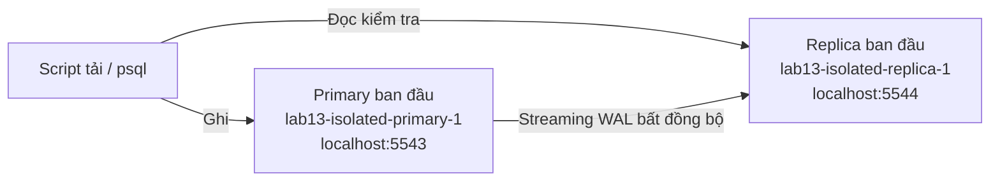
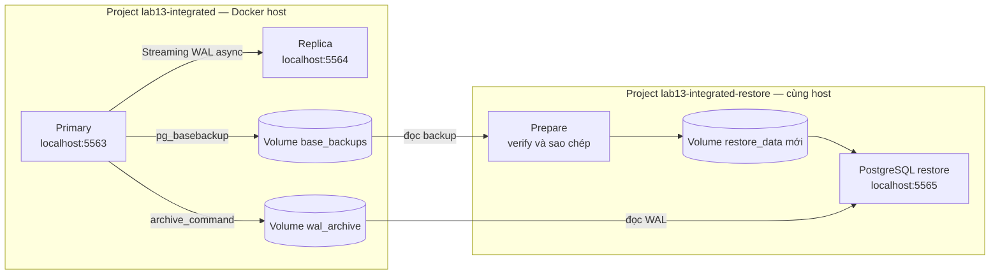
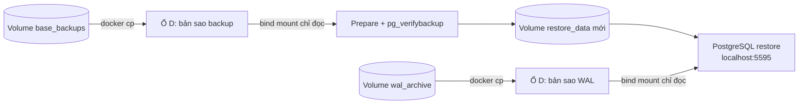

# Kiến trúc các môi trường thử nghiệm

Các sơ đồ mô tả **những môi trường khác nhau**, chạy trên cùng một Docker
host trong các lần thử đã lưu. Tên container, cổng và trạng thái là của
những lần thử; không suy ra trạng thái hiện tại chỉ từ tên container.

## 1. HA: replication và failover có kiểm soát

Trước khi chuyển đổi, client/script ghi vào primary và có thể kiểm tra
đơn trên replica. WAL được truyền bất đồng bộ.

Khi failover, người vận hành dừng primary, promote replica và chuyển
đích ghi bằng script. Node được promote giữ tên container `replica-1`.
Chưa có cơ chế tự động phát hiện sự cố hoặc endpoint ứng dụng tự chuyển.
Trên cụm riêng `lab13-bootstrap-check`, nhóm đã tạo **replica mới từ
volume rỗng** sau promote; chưa đưa primary cũ tái gia nhập.

Các cụm `lab13-repeat` (5573/5574) và `lab13-rpo` (5583/5584) là các
project thử riêng để đo lặp và failover khi có tải; không phải các node
thêm vào cụm `lab13-isolated`.

Chi tiết: [failover](../infra/FAILOVER.md), [tạo replica mới](../infra/REJOIN.md),
[kết quả khi có tải](../results/RPO-FO-20261118-165349-5aac44.md).

## 2. Cụm tích hợp replication và PITR

Sơ đồ này mô tả run `INT-20261118-150553`. Base backup và WAL archive
là **hai Docker volume riêng**, nhưng đều ở cùng Docker host với nguồn.
Thao tác xóa trên primary được replica nhận qua replication; restore
dùng base backup và WAL để trở về mốc trước khi xóa.

Đường nối `restore_data` thể hiện container restore sử dụng volume sau
bước prepare. Chữ `localhost` là cổng bind của máy host, không phải cổng
PostgreSQL bên trong container. Chi tiết: [runbook PITR tích hợp](INTEGRATED_PITR.md)
và [kết quả, CSV](../results/INT-20261118-150553/README.md).

## 3. Khôi phục từ bản sao trên ổ D

Run ngày 19/11/2026 sao chép base backup và WAL archive từ Docker volume
sang thư mục ổ D. Các thư mục này được gắn **chỉ đọc** vào project restore;
`prepare` kiểm tra và chép backup sang volume restore mới.

Ổ D nằm trên cùng máy, nên bản sao này **chưa bảo vệ khỏi mất toàn bộ
host**. Nhóm đã kiểm tra `pg_verifybackup`, so hash bốn WAL segment,
phục hồi 4 dòng/checksum khớp và kiểm tra ghi–đọc. Chi tiết:
[kết quả phục hồi từ ổ D](../results/HOST-COPY-PITR-20261119.md).

## 4. Giới hạn chung

- Docker volumes, ổ D và các container đã thử đều ở cùng host; chưa có
  minh chứng khôi phục từ bản sao trên thiết bị khác.
- Failover được kích hoạt thủ công và đo trong điều kiện lab; các số đo
  không bao gồm tự động phát hiện lỗi hoặc chuyển endpoint ứng dụng.
- Chưa kiểm chứng retention tự động, mã hóa backup hay lỗi toàn host.
- Không khởi động primary cũ hoặc chạy lại toàn bộ Compose trên volume
  đã promote khi chưa có quy trình tái gia nhập phù hợp.
