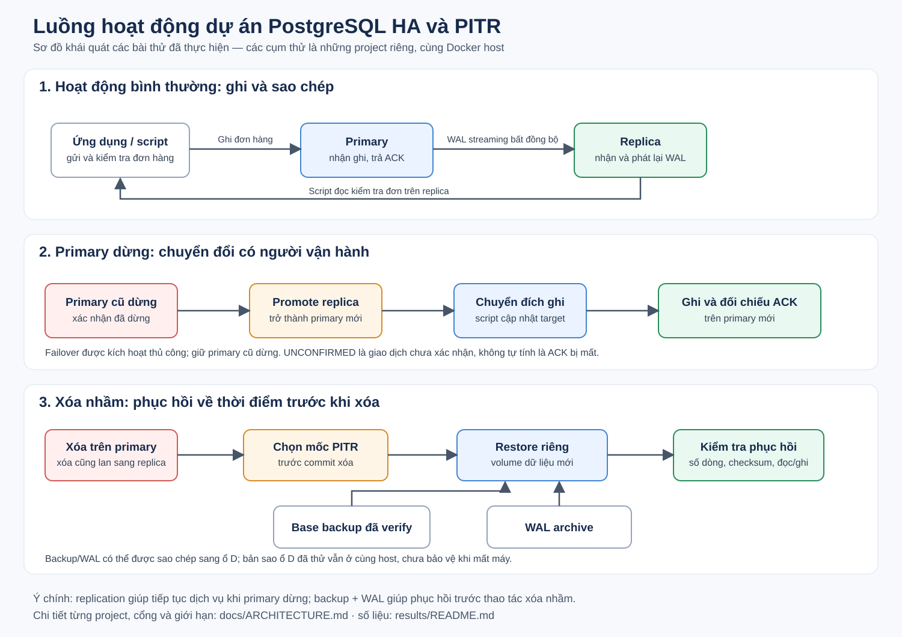

# Luồng hoạt động dự án

Mở file Markdown này trong VS Code và nhấn `Ctrl+Shift+V` để xem sơ đồ;
hoặc mở trực tiếp [file SVG](luong-hoat-dong.svg). Sơ đồ là mô hình giải
thích chung, không có nghĩa mọi bước đã chạy trong cùng một project.

1. **Bình thường:** script ghi đơn vào primary; replica nhận WAL bất đồng
   bộ. Script có thể đọc replica để kiểm tra đơn đã xuất hiện.
2. **Primary dừng:** người vận hành xác nhận primary cũ dừng, promote
   replica và chuyển đích ghi. Script đối chiếu các giao dịch đã ACK;
   giao dịch UNCONFIRMED được báo riêng. Failover chưa tự phát hiện lỗi.
3. **Xóa nhầm:** lệnh xóa lan sang replica. Nhóm dùng base backup cùng
   WAL archive để PITR đến trước commit xóa trên một volume restore mới;
   sau đó so số dòng/checksum và kiểm tra ghi–đọc.

Trong lần thử đã lưu, replication/failover và PITR chạy trên các cụm
khác nhau; bài thử `lab13-integrated` đã kết hợp replication và PITR.
Bản sao trên ổ D vẫn cùng host, không bảo vệ khỏi mất toàn bộ máy. Xem
[kiến trúc từng môi trường](ARCHITECTURE.md) và [kết quả](../results/README.md).
